<div align="center" dir="rtl">

# رفيق · Rafiq

### رفيقٌ يرافقني في رحلة العناية بنفسي

تطبيق عربي هادئ وخاص، يرافقني في عشر خطوات للعناية بنفسي، ويبقى كل ما أكتبه فيه **على جهازي فقط**.

[](https://rafiq-iota-neon.vercel.app)


<table>
  <tr>
    <td align="center">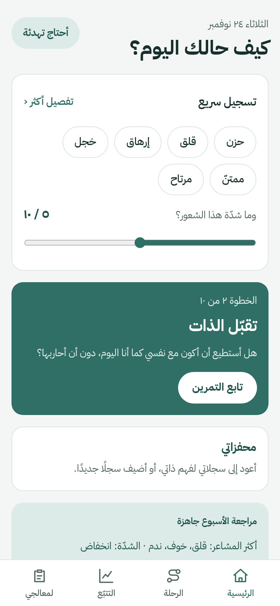<br><sub>الرئيسية</sub></td>
    <td align="center">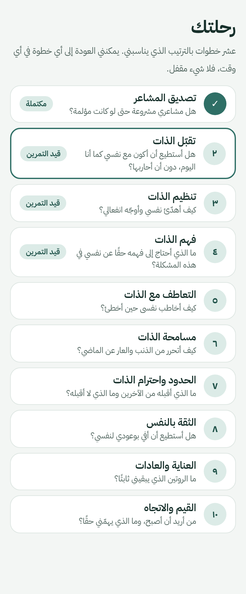<br><sub>الرحلة</sub></td>
    <td align="center">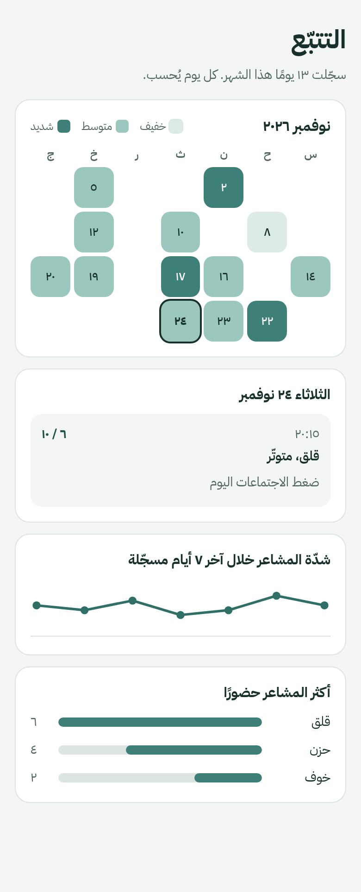<br><sub>التتبّع</sub></td>
    <td align="center">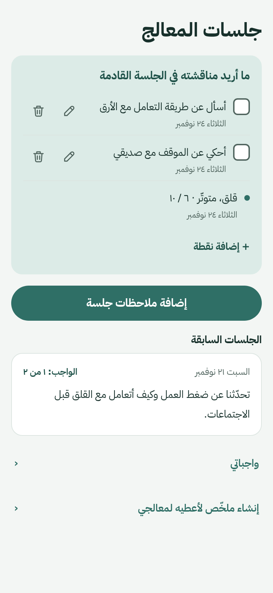<br><sub>جلسات المعالج</sub></td>
  </tr>
</table>

<sub>كل اللقطات في هذا الدليل من بيانات تجريبية، وليست سجلات حقيقية.</sub>

</div>

<div dir="rtl">

## المحتويات

1. [ما هو رفيق؟](#ما-هو-رفيق)
2. [تنبيه مهم](#تنبيه-مهم)
3. [التثبيت](#التثبيت)
4. [جولة في التطبيق](#جولة-في-التطبيق)
   - [الرئيسية](#الرئيسية)
   - [تسجيل المشاعر](#تسجيل-المشاعر)
   - [التتبّع](#التتبّع)
   - [الرحلة: عشر خطوات](#الرحلة-عشر-خطوات)
   - [التمارين الموجّهة](#التمارين-الموجّهة)
   - [محفّزاتي](#محفّزاتي)
   - [أحتاج تهدئة](#أحتاج-تهدئة)
   - [جلسات المعالج](#جلسات-المعالج)
   - [واجباتي](#واجباتي)
   - [ملخّص للمعالج](#ملخّص-للمعالج)
   - [خطة السنة](#خطة-السنة)
   - [الإعدادات](#الإعدادات)
5. [النسخ الاحتياطي ونقل بياناتي](#النسخ-الاحتياطي-ونقل-بياناتي)
6. [الخصوصية](#الخصوصية)
7. [أسئلة شائعة](#أسئلة-شائعة)
8. [للمطوّرين](#للمطوّرين)
9. [إخلاء مسؤولية](#إخلاء-مسؤولية)

---

## ما هو رفيق؟

رفيق تطبيق عربي (من اليمين إلى اليسار) يرافقني في عشر خطوات للعناية بنفسي. أبدأ بتصديق مشاعري، ثم أتقبّل نفسي، وأتعلّم تنظيمها، وأفهمها، وأتعاطف معها، وأسامحها، وأضع حدودي، وأبني ثقتي بنفسي، وأعتني بعاداتي، وأحدّد قيمي واتجاهي.

ما الذي يميّزه؟

- **هادئ:** لا سلاسل أيام تضغط عليّ، ولا إشعارات تلومني، ولا درجات. أسجّل حين أريد.
- **خاص:** لا حساب، ولا خادم، ولا تتبّع. كل شيء محفوظ على جهازي.
- **يعمل دون إنترنت:** بعد أول فتح يعمل كاملًا بلا اتصال.
- **مرتبط بالعلاج:** يساعدني على تجهيز ما أقوله لمعالجي، وتسجيل ملاحظات الجلسات والواجبات، وطباعة ملخّص أسلّمه له.

## تنبيه مهم

رفيق أداة مساعدة ذاتية. ليس جهازًا طبيًا، ولا يقدّم تشخيصًا ولا علاجًا، ولا يحلّ محل المعالج النفسي. إن شعرتُ بأنني قد أكون في خطر، أتواصل فورًا مع خدمات الطوارئ في بلدي أو مع شخص أثق به. وفي التطبيق صفحة «أحتاج تهدئة» فيها أرقام الدعم.

## التثبيت

### على الهاتف أو الحاسوب (من المتصفح)

1. أفتح [rafiq-iota-neon.vercel.app](https://rafiq-iota-neon.vercel.app).
2. من قائمة المتصفح أختار **«إضافة إلى الشاشة الرئيسية»** (أو «تثبيت التطبيق»).
3. يظهر رفيق كتطبيق مستقل، ويعمل دون إنترنت.

### على أندرويد (ملف APK)

1. أنزّل ملف `rafiq-0.1.0-release.apk` وأفتحه على الهاتف.
2. إن طلب الهاتف ذلك، أسمح بالتثبيت من هذا المصدر.
3. بيانات تطبيق أندرويد مستقلة عن بيانات المتصفح. أنقلها بنسخة احتياطية إن أردت ([انظر النسخ الاحتياطي](#النسخ-الاحتياطي-ونقل-بياناتي)).

> يحتاج بناء الـ APK إلى مفتاح توقيع يملكه صاحب المشروع. لا يوجد مفتاح داخل المستودع.

---

## جولة في التطبيق

في أسفل الشاشة أربعة أقسام: **الرئيسية**، **الرحلة**، **التتبّع**، **لمعالجي**. وفي أعلى الرئيسية زر **«أحتاج تهدئة»** يبقى قريبًا في كل وقت.

### الرئيسية

<table dir="rtl">
<tr>
<td width="260"></td>
<td valign="top">

أول ما أراه حين أفتح التطبيق:

- **«كيف حالك اليوم؟»** وتحته **تسجيل سريع**: أختار شعورًا أو أكثر، وأحرّك الشريط لأحدّد شدّته من صفر إلى عشرة، ثم أحفظ في لحظات. «تفصيل أكثر» يفتح الصفحة الكاملة.
- **بطاقة الخطوة الحالية:** تذكّرني بالخطوة التي أعمل عليها، وتحمل زر «تابع التمرين».
- **محفّزاتي:** طريق مختصر إلى سجلّي لفهم ما يزعجني.
- **مراجعة الأسبوع:** تظهر حين يكتمل أسبوع، وفيها أكثر مشاعري حضورًا واتجاه الشدّة وسؤال للتأمل.
- شريط تذكير هادئ في الأعلى: تذكير يومي بالتسجيل، وتذكير بنسخة احتياطية إن مرّت ٢١ يومًا دون نسخة.

</td>
</tr>
</table>

### تسجيل المشاعر

<table dir="rtl">
<tr>
<td width="260">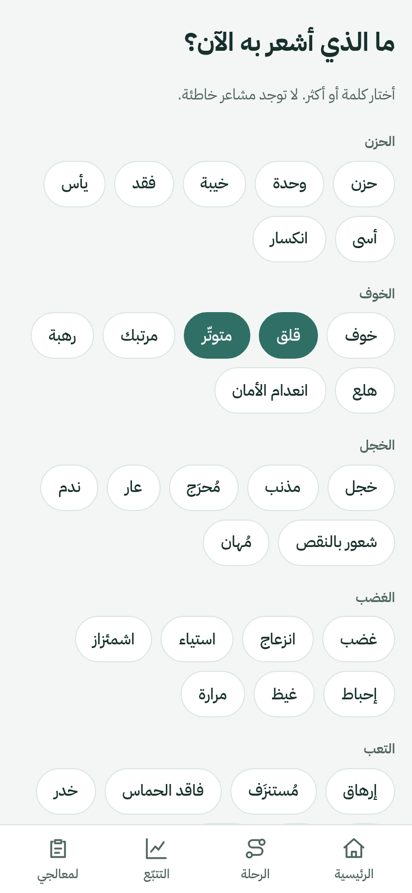</td>
<td valign="top">

صفحة التسجيل الكاملة تتّسع لما أشعر به:

1. **أختار كلمات المشاعر.** مرتّبة في مجموعات: الحزن، الخوف، الخجل، الغضب، التعب، وغيرها. يمكنني اختيار أكثر من كلمة.
2. **أحدّد الشدّة** من ٠ إلى ١٠.
3. **أضيف وسومًا** (النوم، العمل، العلاقات، الجسد، الوحدة) **وملاحظة** إن أردت.
4. **أعلّم التسجيل «للجلسة القادمة»** فيظهر لاحقًا في أجندة معالجي.

</td>
</tr>
</table>

### التتبّع

<table dir="rtl">
<tr>
<td width="260"></td>
<td valign="top">

- **تقويم الشهر** يلوّن الأيام التي سجّلتُ فيها فقط، بثلاث درجات: خفيف ومتوسط وشديد.
- أضغط على أي يوم فأرى ما سجّلتُه فيه.
- **منحنى الشدّة** لآخر سبعة أيام مسجّلة.
- **أكثر المشاعر حضورًا** في الشهر.

لا سلاسل أيام ولا لوم: اليوم الذي لا أسجّل فيه يبقى فارغًا دون تعليق.

</td>
</tr>
</table>

<details>
<summary>الوضع الداكن</summary>
<br>
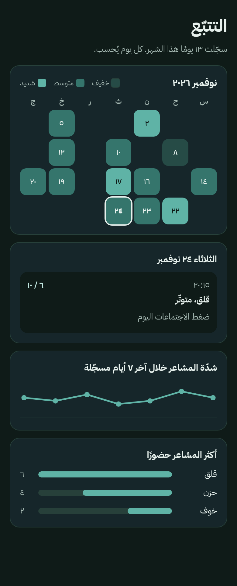
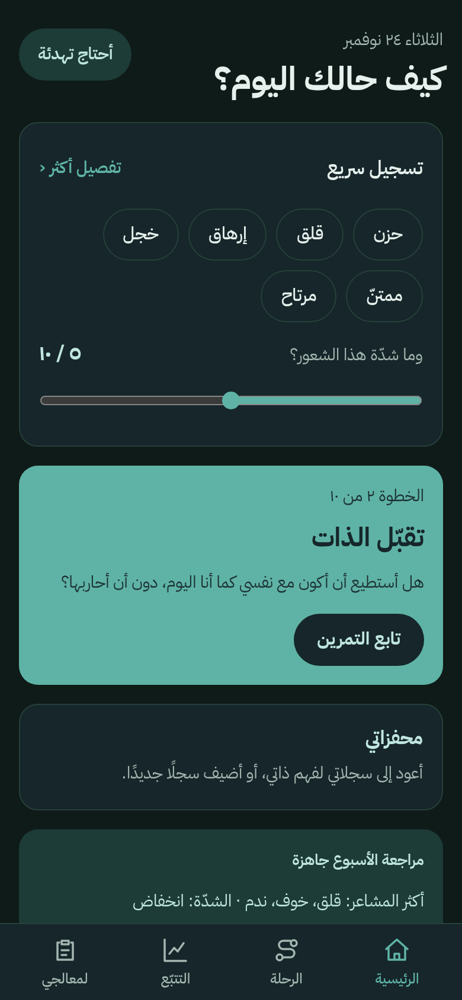
</details>

### الرحلة: عشر خطوات

<table dir="rtl">
<tr>
<td width="260"></td>
<td valign="top">

عشر خطوات أمشيها بالترتيب الذي يناسبني، ويمكنني العودة إلى أي خطوة في أي وقت. لا شيء مقفل.

| # | الخطوة | سؤالها الأساسي |
|---|---|---|
| ١ | تصديق المشاعر | هل مشاعري مشروعة حتى لو كانت مؤلمة؟ |
| ٢ | تقبّل الذات | هل أستطيع أن أكون مع نفسي كما أنا اليوم؟ |
| ٣ | تنظيم الذات | كيف أهدّئ نفسي وأوجّه انفعالي؟ |
| ٤ | فهم الذات | ما الذي أحتاج إلى فهمه حقًا عن نفسي؟ |
| ٥ | التعاطف مع الذات | كيف أخاطب نفسي حين أخطئ؟ |
| ٦ | مسامحة الذات | كيف أتحرر من الذنب والعار عن الماضي؟ |
| ٧ | الحدود واحترام الذات | ما الذي أقبله من الآخرين وما الذي لا أقبله؟ |
| ٨ | الثقة بالنفس | هل أستطيع أن أفي بوعودي لنفسي؟ |
| ٩ | العناية والعادات | ما الروتين الذي يبقيني ثابتًا؟ |
| ١٠ | القيم والاتجاه | من أريد أن أصبح، وما الذي يهمّني حقًا؟ |

حالة كل خطوة تظهر على بطاقتها: «قيد التمرين» أو «مكتملة».

</td>
</tr>
</table>

### التمارين الموجّهة

<table dir="rtl">
<tr>
<td width="260">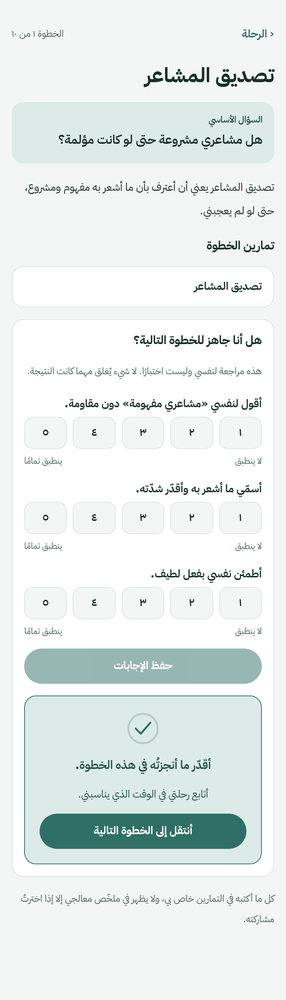</td>
<td width="260">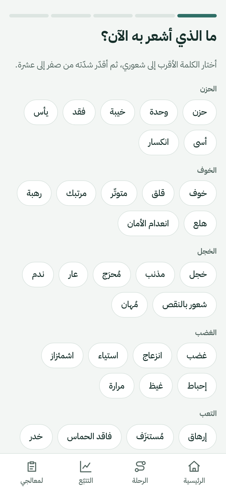</td>
<td valign="top">

حين أفتح خطوة أجد:

- **شرحًا قصيرًا** يوضّح فكرتها.
- **تمارين موجّهة** من أسئلة متفرّعة: ما أجيب به يحدّد السؤال التالي.
- **حفظًا تلقائيًا للمسودة:** إن خرجتُ في منتصف تمرين يبقى كما تركتُه وأكمله لاحقًا.
- **فحص جاهزية لطيف** قبل بعض الخطوات، ليتأكّد التطبيق أنني مستعد.
- في الخطوة الثالثة **متابعة بعد التمرين**: هل ساعدني ما جرّبتُه؟ وكم انخفضت الشدّة؟
- في خطوات التعاطف والمسامحة والامتنان **رسائل** أكتبها لنفسي.

الخطوات ١–٣ تتبع البنية التي وضعها معالج صاحب المشروع. أما ٤–١٠ فمسودات يراجعها مختص قبل أي استخدام أوسع.

</td>
</tr>
</table>

### محفّزاتي

<table dir="rtl">
<tr>
<td width="260">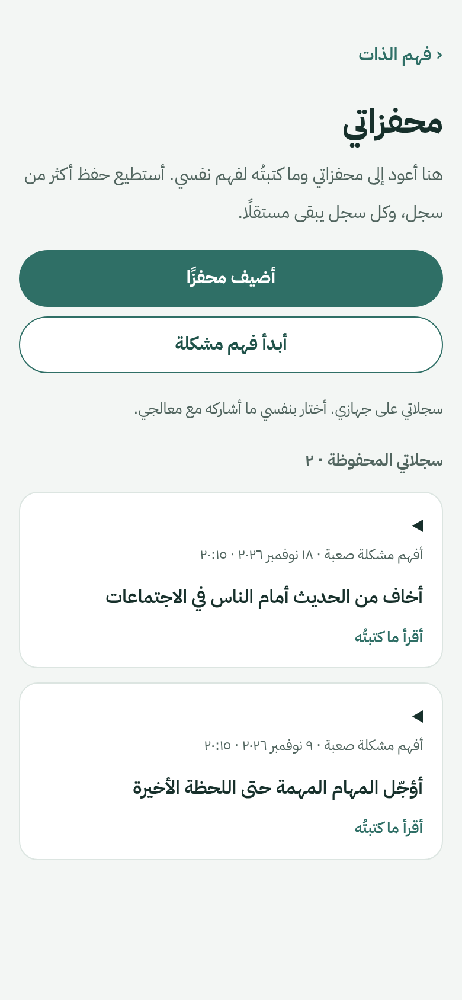</td>
<td valign="top">

سجلّ لما يزعجني. أبدأ **«فهم مشكلة»** وهو تمرين الخطوة الرابعة، وأجيب عن خمسة أسئلة:

1. ما المشكلة في جملة واحدة؟
2. ماذا يقول لي صوت الخزي عني بسبب هذه المشكلة؟
3. ما الذي يحاول هذا النمط أن يحميني منه؟
4. ما الذي كان ينقصني كلما حاولتُ التغيير؟
5. ماذا كان سيقول صديق منصف، لا يحكم عليّ، عن قصتي؟

تظهر سجلاتي المكتملة في قائمة. أفتح أي سجلّ فأقرأه، وأستطيع **تعديله** أو **حذفه** (مع تأكيد قبل الحذف).

</td>
</tr>
</table>

### أحتاج تهدئة

<table dir="rtl">
<tr>
<td width="260">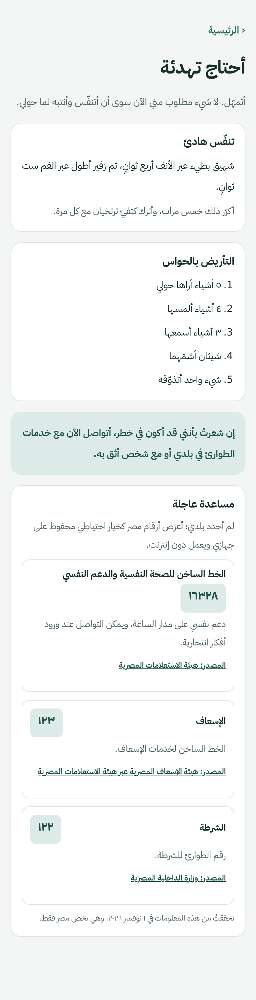</td>
<td valign="top">

زر واحد من الرئيسية، وصفحة تقول لي: «لا شيء مطلوب منّي الآن سوى أن أتنفّس».

- **تنفّس هادئ:** شهيق بطيء أربع ثوانٍ، وزفير أطول ست ثوانٍ، خمس مرات.
- **التأريض بالحواس:** ٥ أشياء أراها، ٤ ألمسها، ٣ أسمعها، شيئان أشمّهما، شيء واحد أتذوّقه.
- **مساعدة عاجلة:** إن شعرتُ بأنني قد أكون في خطر، أجد أرقام الدعم المحلية. أختار بلدي من الإعدادات، وإن لم أحدّده تظهر أرقام مصر كخيار احتياطي، وكل رقم معه مصدره وتاريخ التحقق منه. الأرقام محفوظة في التطبيق وتعمل دون إنترنت.

</td>
</tr>
</table>

### جلسات المعالج

<table dir="rtl">
<tr>
<td width="260"></td>
<td width="260">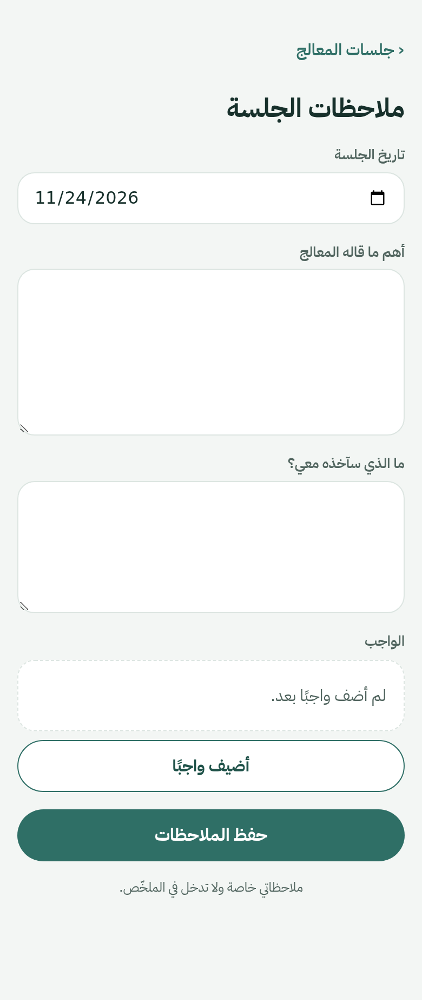</td>
<td valign="top">

قسم «لمعالجي» يجمع كل ما يخصّ جلساتي:

- **«ما أريد مناقشته في الجلسة القادمة»:** أجندة تتجمّع فيها النقاط التي أضفتُها بنفسي، والتسجيلات التي علّمتُها «للجلسة القادمة». أعدّل النقاط وأحذفها وأعلّمها منجزة.
- **«إضافة ملاحظات جلسة»:** أكتب ما قاله المعالج، وما أخذتُه معي من الجلسة، وأضيف الواجبات.
- **الجلسات السابقة:** كل جلسة بتاريخها وعدد الواجبات المنجزة.
- طريقان سريعان: **«واجباتي»** و**«إنشاء ملخّص لأعطيه لمعالجي»**.

</td>
</tr>
</table>

### واجباتي

<table dir="rtl">
<tr>
<td width="260">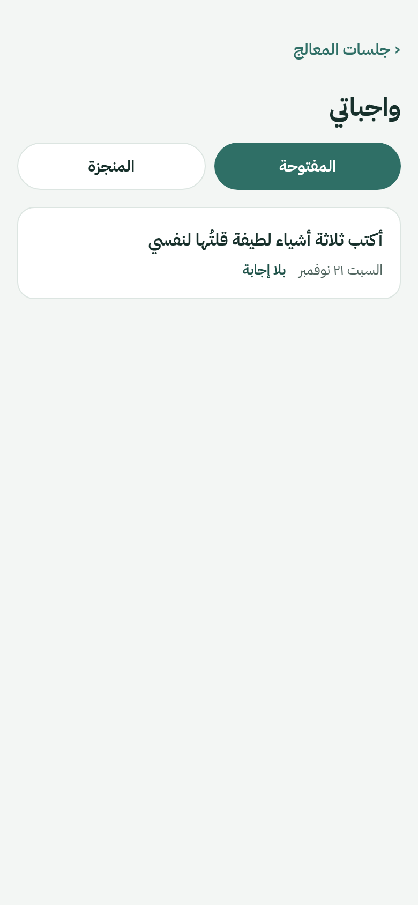</td>
<td width="260">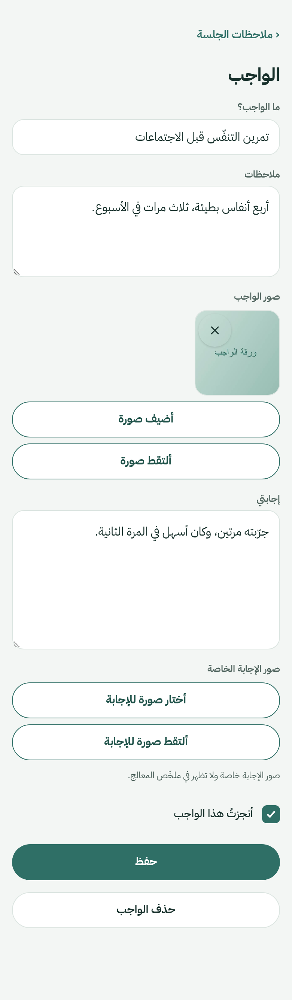</td>
<td valign="top">

كل واجب له سجلّه الخاص، فلا يضيع بين الملاحظات:

- **العنوان والملاحظات:** ما المطلوب بالضبط.
- **صور الواجب:** حتى ٦ صور، من المعرض أو بالكاميرا. تُصغَّر الصورة تلقائيًا وتبقى على جهازي.
- **إجابتي:** مكان لأكتب إجابتي، مع **صور خاصة بالإجابة** لا تظهر في ملخّص المعالج.
- **«أنجزتُ هذا الواجب»:** علامة إنجاز.
- **قائمة «واجباتي»** تجمع كل الواجبات من كل الجلسات، والمفتوح منها أولًا.
- الحفظ تلقائي عند الخروج من الصفحة، ويمكنني حذف أي واجب.

</td>
</tr>
</table>

### ملخّص للمعالج

<table dir="rtl">
<tr>
<td width="260">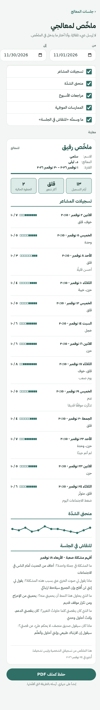</td>
<td valign="top">

ورقة منظّمة بحجم A4 أسلّمها لمعالجي، ولا يُرسَل شيء إلى أي مكان:

1. **أحدّد الفترة** (من/إلى).
2. **أختار ما يدخل فيها:** تسجيلات المشاعر، منحنى الشدّة، مراجعات الأسبوع، الممارسات الموجّهة، ونقاط «للنقاش في الجلسة».
3. **أرى المعاينة** كما ستُطبع: اسمي واسم معالجي وفترة الملخّص وعدد أيام التسجيل وأكثر شعور حضورًا وما اخترتُه.
4. **أحفظ ملفًا PDF** أو أطبعها.

الممارسات التي لم أُعلّمها للمشاركة تبقى خاصة ولا تدخل الملخّص. صور الإجابة كذلك.

</td>
</tr>
</table>

### خطة السنة

<table dir="rtl">
<tr>
<td width="260">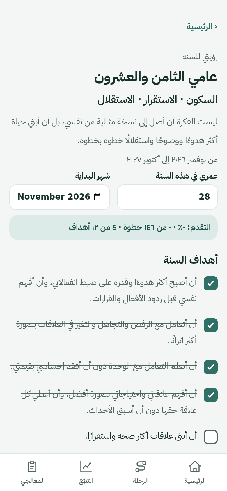</td>
<td valign="top">

خطة من اثني عشر شهرًا تبدأ من الشهر الذي أختاره:

- **رؤيتي للسنة** وعنوانها يتبع عمري الذي أدخله («عامي الثامن والعشرون»).
- **أهداف السنة** أعلّمها كلما أنجزتُ هدفًا، ويظهر **تقدّمي** في أعلاها.
- **شهر بشهر:** لكل شهر موضوعه (فهم نفسي ومشاعري، الهدوء والتحكم في ردود الفعل، العلاقات…)، وخطوات أسبوعية أعلّمها، وملاحظة تحت كل خطوة.
- **مراجعة السنة:** أسئلة أجيب عنها في آخر الرحلة.

</td>
</tr>
</table>

### الإعدادات

<table dir="rtl">
<tr>
<td width="260">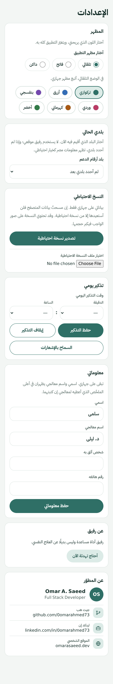</td>
<td valign="top">

- **المظهر:** تلقائي أو فاتح أو داكن، و**ستة ألوان مفضّلة** (تركوازي، أزرق، بنفسجي، وردي، كهرماني، أخضر) تلوّن التطبيق كله.
- **بلدي الحالي:** يحدّد أرقام الدعم المحلية في صفحة «أحتاج تهدئة».
- **النسخ الاحتياطي:** تصدير واستيراد، وفي أندرويد زر **مشاركة نسخة احتياطية** ([التفاصيل](#النسخ-الاحتياطي-ونقل-بياناتي)).
- **تذكير يومي** بوقت أختاره (في أندرويد). التذكير غير دقيق عمدًا ليوفّر البطارية، ولا يلوم إن فاتني.
- **معلوماتي:** اسمي واسم معالجي وشخص أثق به ورقمه. تبقى على جهازي وتظهر أعلى ملخّص المعالج.
- **عن رفيق** و**عن المطوّر.**

</td>
</tr>
</table>

---

## النسخ الاحتياطي ونقل بياناتي

بياناتي على جهازي فقط. إن مسحتُ بيانات المتصفح أو فقدتُ الهاتف فلن أستعيدها إلا من نسخة احتياطية. ملف النسخة هو ملف JSON فيه كل بياناتي وصوري، **وغير مشفّر**، فأحفظه في مكان آمن.

| ما أريده | ما أفعله |
|---|---|
| حفظ نسخة | الإعدادات ← **تصدير نسخة احتياطية** (في أندرويد أختار مكان الحفظ على جهازي) |
| نقل بياناتي إلى جهاز آخر | في أندرويد: **مشاركة نسخة احتياطية** ← أرسلها إلى الجهاز الآخر عبر أي تطبيق أثق به، ثم أستوردها هناك |
| الاستعادة | **اختيار ملف النسخة الاحتياطية** ← أختار الطريقة ← **استيراد** |

عند الاستيراد أختار بين:

- **دمج مع بياناتي:** أحتفظ بالأحدث عند التعارض.
- **استبدال بياناتي الحالية:** يمحو ما عندي ويضع ما في الملف.

يتحقّق التطبيق من الملف قبل أن يلمس بياناتي، والاستيراد إمّا أن ينجح كاملًا أو لا يغيّر شيئًا. ولا يتغيّر شيء قبل أن أؤكّد.

**ملاحظة عن «المشاركة»:** رسالة «فتحتُ قائمة المشاركة» تعني أن القائمة ظهرت فقط، ولا تثبت أن الملف وصل. والمشاركة لا تُحسب نسخة محفوظة ولا تصفّر تذكير النسخ.

## الخصوصية

- كل شيء محفوظ في **IndexedDB** داخل المتصفح (أو داخل تطبيق أندرويد). لا يُرفع شيء.
- لا حساب، ولا تحليلات، ولا كوكيز، ولا خطوط خارجية: خط IBM Plex Sans Arabic مضمَّن في التطبيق.
- المشاركة اختيارية دائمًا: ملاحظاتي وممارساتي خاصة ما لم أقرّر مشاركتها، وملخّص المعالج لا يحتوي إلا ما اخترتُه.
- في أندرويد لا يطلب التطبيق إذن الكاميرا ولا التخزين. الصور تُختار من المعرض أو تُلتقط عبر نافذة النظام.
- نسخة أندرويد تستثني بياناتها من النسخ الاحتياطي التلقائي لجوجل، فلا تغادر الجهاز إلا بنسخة أصدرها أنا.

## أسئلة شائعة

**هل أحتاج إنترنت؟** بعد أول فتح لا. التطبيق كله يعمل دون اتصال.

**هل بياناتي في المتصفح هي نفسها في تطبيق أندرويد؟** لا، كل واحد منهما يحفظ بياناته وحده. أنقلها بنسخة احتياطية.

**هل يمكنني مزامنة جهازين تلقائيًا؟** لا. جرّبنا المزامنة المباشرة بين جهازين، لكنها تتعطّل على شبكات كثيرة، فاعتمدنا بدلًا منها المشاركة والاستيراد.

**نسيتُ الاسم الذي كتبتُه أو أخطأتُ فيه.** من الإعدادات ← «معلوماتي» أعدّله وأحفظ.

**لا أريد أن يرى أحد ما كتبتُه.** لا يراه أحد: لا يوجد حساب ولا خادم. أما من يستعمل جهازي نفسه فقد يراه، فأستخدم قفل الهاتف.

**كيف أحذف كل شيء؟** أمسح بيانات الموقع من المتصفح، أو أُزيل تطبيق أندرويد. أصدر نسخة احتياطية قبل ذلك إن أردت الاحتفاظ بشيء.

## للمطوّرين

**التقنيات:** React 18 · TypeScript (صارم) · Vite 5 · React Router 6 · Tailwind CSS (خصائص منطقية ومتغيّرات CSS) · Dexie فوق IndexedDB · Zod · vite-plugin-pwa · Capacitor 8 لأندرويد · Vitest وTesting Library · Playwright.

```bash
npm install
npm run dev          # http://localhost:5173
npm test             # اختبارات الوحدة والمكوّنات (Vitest)
npx tsc --noEmit     # فحص الأنواع
npm run build        # فحص الأنواع + بناء الإنتاج
npm run preview      # تشغيل بناء الإنتاج
npm run e2e          # اختبارات المتصفح الشاملة (Playwright)
npm run android:sync # بناء ويب أندرويد ومزامنته مع المشروع الأصلي
```

**أندرويد:** مشروع Capacitor داخل `android/` بإضافة محلية `RafiqDocuments` لحفظ النسخ وقراءتها ومشاركتها وطباعة الملخّص. بناء النسخة المُوقَّعة:

```bash
cd android && ./gradlew :app:assembleRelease
```

يقرأ البناء بيانات التوقيع من `~/.rafiq-signing/keystore.properties` خارج المستودع. ولا تشغّل اختبارات الأجهزة (`connectedDebugAndroidTest`) على هاتفك الحقيقي لأنها تُزيل التطبيق وتمحو بياناته. استخدم محاكيًا عبر `ANDROID_SERIAL`.

**هيكل المشروع:**

```
src/content/    الخطوات والتمارين والمشاعر وخطة السنة وأرقام الدعم (مكتوبة ومُتحقَّق منها)
src/db/         أنواع السجلات، واجهة Repo، مخزن Dexie ومخزن الذاكرة، النسخ الاحتياطي
src/features/   home, checkin, tracker, journey, step, practice, triggers, therapist, summary, yearplan, calm, settings
src/platform/   جسور أندرويد: المستندات، الإشعارات، دورة الحياة، الإطلاق
src/components/ مكوّنات مشتركة
src/lib/        التواريخ، الأرقام، الألوان، الصور، الاتجاهات، التذكيرات
android/        مشروع Capacitor والاختبارات الأصلية
e2e/            اختبارات المتصفح الشاملة
```

**النشر:** موقع ثابت. يعيد `vercel.json` كل مسار إلى `index.html` لتعمل الروابط العميقة. لا خادم ولا متغيّرات بيئة.

**الحالة:** بُني الاختبار أولًا، ويسجّل `HANDOFF.md` موضع المشروع وكل قرار اتُّخذ أثناء البناء. محتوى الخطوات ٤–١٠ وبعض الأسئلة مسودات تحتاج مراجعة معالج قبل استخدام أوسع.

**إعادة التقاط لقطات هذا الدليل:** أشغّل `npm run dev -- --port 5199`، ثم أزرع بيانات تجريبية وأصوّر الصفحات بمقاس ٣٩٠×٨٤٤ في Playwright. اللقطات في `screenshots/`.

## إخلاء مسؤولية

رفيق أداة مساعدة ذاتية، وليس جهازًا طبيًا ولا يقدّم تشخيصًا أو علاجًا. إن كنتُ في أزمة، أتصل بخدمات الطوارئ المحلية أو بشخص أثق به فورًا.

<div align="center">

صُنع بعناية · **Omar A. Saeed** · Full Stack Developer

</div>

</div>
